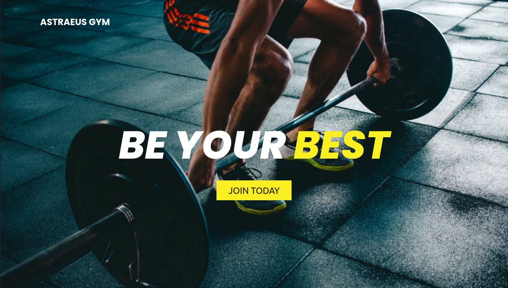

# Raw Strength - Fitness & Gym Website



A bold, modern, and fully responsive single-page website for **Raw Strength** — designed for fitness clubs, athletic training centers, and gym facilities. Built with clean HTML5 and CSS3, it delivers high performance, sharp typography, and seamless adaptability across mobile, tablet, and desktop devices.

---

## 📌 Table of Contents
- [Overview](#overview)
- [Key Features](#key-features)
- [Website Sections](#website-sections)
- [Contact Details](#contact-details)
- [Tech Stack](#tech-stack)
- [Folder Structure](#folder-structure)
- [Getting Started](#getting-started)
- [Customization Guide](#customization-guide)
- [License & Credits](#license--credits)

---

## 🏋️ Overview

**Raw Strength** is a single-page fitness website created to showcase high-intensity training programs, community-driven group classes, and personal coaching. Featuring a bold black-and-yellow aesthetic with italicized dynamic headings, the site is crafted to inspire visitors to take action and unleash their best selves.

---

## ✨ Key Features

- **Zero Framework Overhead:** Pure HTML5 and CSS3 with lightning-fast load times.
- **Fully Responsive Design:** Seamlessly transitions between mobile devices, tablets, and wide desktop screens.
- **Brand Consistency:** Cohesive dark aesthetic with energetic yellow accents powered by CSS custom properties.
- **Direct Contact & Alternative Channels:** Includes primary and alternative mailing addresses, email channels, and phone numbers.
- **Smooth Navigation:** In-page anchor linking with CSS smooth scrolling.
- **Interactive Elements:** Button hover animations, responsive flex layouts, and modern iconography.

---

## 📑 Website Sections

1. **Hero Section (`#home`)**
   - Brand logo: **RAW STRENGTH**
   - Motivational headline: *"Be your best"*
   - High-contrast Call-to-Action button directing to contact/membership.

2. **About Us (`#about`)**
   - *"About our fit family"* — Brand history and national presence across 115+ locations nationwide.
   - High-energy fitness imagery and "Learn more" CTA.

3. **Offerings (`#offer`)**
   - *"What we offer"* — Highlighting core gym services:
     - **Tour our gym**
     - **Check out our group classes**
     - **Ask about personal training**

4. **Testimonials (`#testimonials`)**
   - Real member feedback and transformation quotes from diverse community members.

5. **Contact & Footer (`#contact`)**
   - *"Get in touch today"* full-width graphic banner.
   - Comprehensive contact grid featuring both primary and alternative contact methods.
   - Official copyright footer.

---

## 📞 Contact Details

The website includes both primary and alternative contact details for quick communication:

| Channel | Primary Detail | Alternative Detail |
| :--- | :--- | :--- |
| **Mailing Address** | 104 Iron Forge Boulevard, Suite 250, Austin, TX 78701 | 742 Powerhouse Way, Brooklyn, NY 11201 |
| **Email Address** | [contact@rawstrength.com](mailto:contact@rawstrength.com) | [support@rawstrength.com](mailto:support@rawstrength.com) |
| **Phone Number** | [+1 (800) 555-7876](tel:+18005557876) | [+1 (555) 729-7876](tel:+15557297876) |

---

## 💻 Tech Stack

- **HTML5:** Semantic markup structure.
- **CSS3:** Custom properties (CSS variables), Flexbox, CSS Grid, media queries, and smooth scrolling.
- **Google Fonts:** [Poppins](https://fonts.google.com/specimen/Poppins) (Weights: 100 to 900, with italic styles).
- **Icons:** [Ionicons](https://ionic.io/ionicons) (Web Components integration).

---

## 📁 Folder Structure

```text
Raw-Strength/
├── img/
│   ├── about.png          # About section feature photo
│   ├── author-a.png        # Testimonial author 1 portrait
│   ├── author-b.png        # Testimonial author 2 portrait
│   ├── author-c.png        # Testimonial author 3 portrait
│   ├── classes.png         # Group classes card background
│   ├── footer-bg.png       # Contact banner background image
│   ├── hero-bg.png         # Hero banner background image
│   ├── tour.png            # Gym tour card background
│   └── training.png        # Personal training card background
├── fitness.png             # Website preview screenshot
├── index.html              # Main HTML markup
├── style.css               # Main stylesheet and media queries
└── readme.md               # Project documentation
```

---

## 🚀 Getting Started

### Option 1: Direct Browser Launch
1. Clone or download this repository to your local computer.
2. Double-click [index.html](file:///c:/Users/QBS%20Accounting/Documents/websites/Raw-Strength/index.html) to view the site directly in any modern web browser (Chrome, Edge, Firefox, Safari).

### Option 2: Local Development Server (Recommended)
You can run a lightweight development server using one of the following methods:

**Using VS Code Live Server:**
- Open the folder in Visual Studio Code.
- Right-click `index.html` and select **"Open with Live Server"**.

**Using Node.js (`npx serve`):**
```bash
npx serve .
```

---

## 🎨 Customization Guide

### Changing Brand Colors
Open `style.css` and update the CSS variables in the `:root` pseudo-class:

```css
:root {
    --primary-font: 'Poppins', sans-serif;
    --primary-color: #f9ef23;   /* Brand Accent (Yellow) */
    --secondry-color: #141414;  /* Dark Background & Text */
    --third-color: #ffffff;     /* White Elements */
}
```

### Modifying Contact Information
Locate the `<footer class="footer-bottom">` element inside `index.html` to adjust mailing addresses, email links (`mailto:`), or phone numbers (`tel:`).

---

## 📄 License & Credits

- Designed for the **Raw Strength** brand.
- Open-source and free to adapt for personal or commercial fitness projects.
